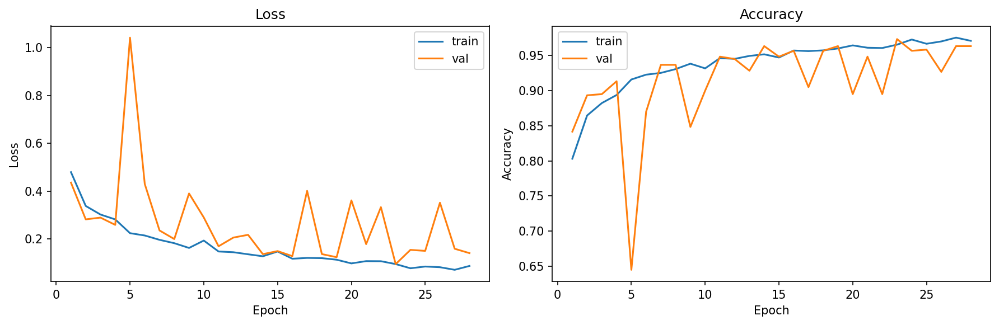
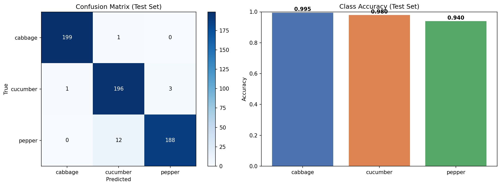
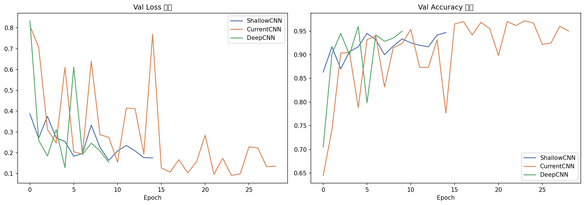
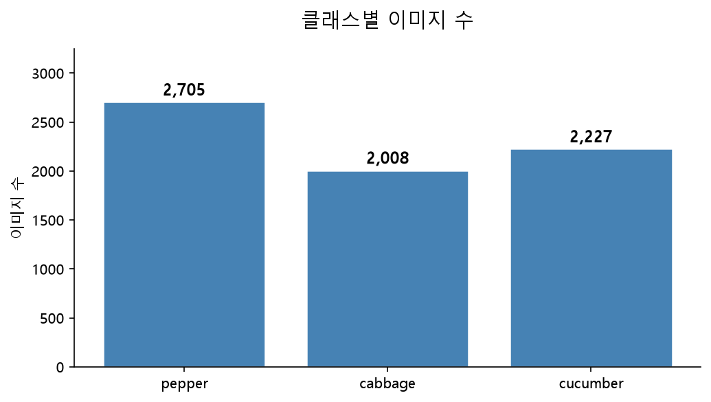
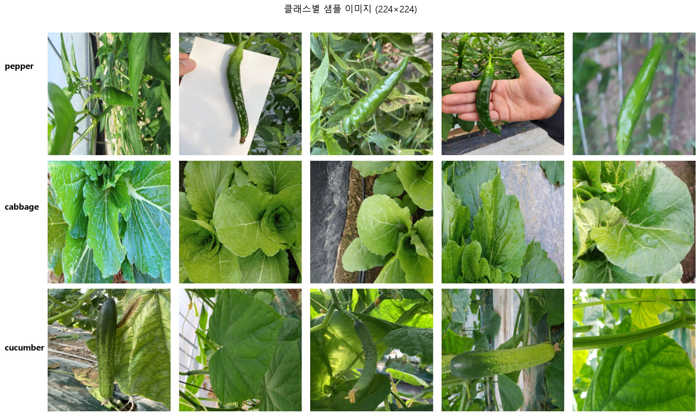
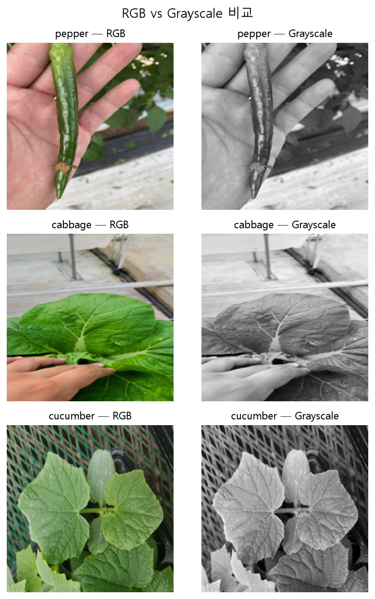
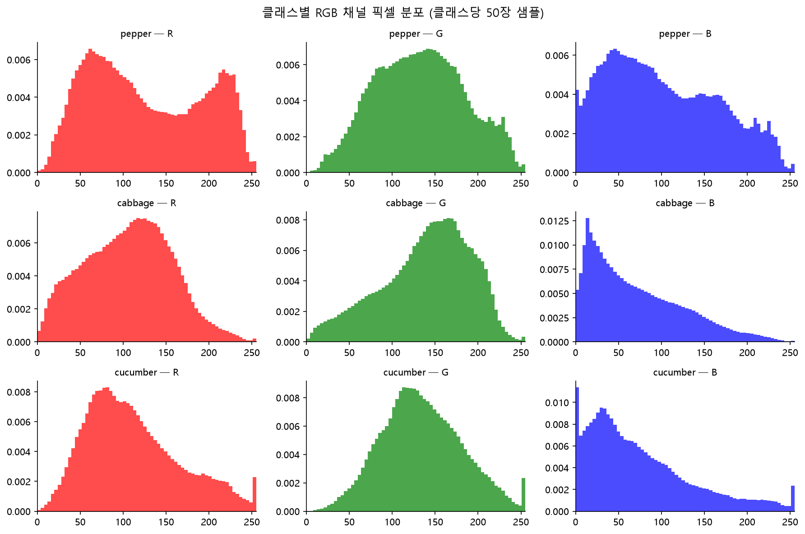

# CNN 작물 이미지 분류

PyTorch CNN으로 작물 3종(고추 / 배추 / 오이) 분류 프로젝트.

---

## 프로젝트 소개

- AI Hub 노지 작물 질병 진단 이미지(정상) 사용, 클래스당 2,000장 언더샘플링, 총 6,000장으로 3종 분류 모델 구현
- EDA, 데이터 파이프라인, CNN 설계 및 학습, Conv 블록 수(3 / 4 / 5) 비교 실험 — 노트북 4개로 구성

---

## 적용 이론 및 구현 내용

| 역량 | 구현 내용 |
|------|-----------|
| EDA | 클래스별 이미지 수, 해상도 분포(클래스당 200장 샘플), RGB 채널 분포, 깨진 이미지 검사 → 언더샘플링 / 224×224 리사이즈 / RGB 유지 결정 |
| 데이터 분할 | `train_test_split` + `stratify`로 train 80% / val 10% / test 10% (4,800 / 600 / 600장) 분할, `SEED=42` 재현성 확보 |
| 정규화 | train 1,500장 샘플링으로 RGB 채널별 mean / std 계산, train만 사용해 val / test 정보 유입 차단 |
| 커스텀 Dataset | `Dataset` 상속, `__len__` / `__getitem__` 구현, transform 외부 주입으로 train / val·test 전처리 분리 |
| 데이터 증강 | train에만 `RandomHorizontalFlip` 적용, val / test는 증강 없이 평가 |
| CNN 설계 | `Conv2d` → `BatchNorm2d` → `ReLU` → `MaxPool2d` 블록 4개(채널 32 / 64 / 128 / 256), `AdaptiveAvgPool2d`, `Dropout(0.5)` — `CropCNN` 422,659 파라미터 |
| 학습 루프 | `CrossEntropyLoss`, `Adam(lr=1e-3)`, 최대 50 에폭, val_loss 기준 Early Stopping(patience=5), val_acc 기준 best 모델 저장 |
| 평가 | best 모델로 test set Confusion Matrix, 클래스별 정확도 산출 |
| 비교 실험 | Conv 블록 3 / 4 / 5개(`ShallowCNN` / `CurrentCNN` / `DeepCNN`) 동일 조건 학습, 파라미터 수와 Best Val Acc 비교 |
| 실행 환경 | Docker로 Jupyter Notebook 환경 구성, GPU(RTX 3080) 학습 환경 재현 |

---

## 구현 결과 및 실행

### 결과 요약

**모델 깊이 비교 (동일 조건, `04. experiments`)**

| 모델 | Conv 블록 | 파라미터 | Best Val Acc | 중단 에폭 |
|------|-----------|----------|--------------|-----------|
| ShallowCNN | 3 | 102,147 | 0.9467 | 15 |
| **CurrentCNN** | **4** | **422,659** | **0.9717** | 29 |
| DeepCNN | 5 | 1,702,659 | 0.9600 | 10 |

- 5블록: 파라미터 약 4배(422K → 1,702K), Best Val Acc 차이 1.17%p → 4블록을 기준 모델로 선택

**기준 모델 Test 평가 (`03.model`)**

| 항목 | 결과 |
|------|------|
| 학습 | 28 에폭 Early Stopping, Best Val Acc 0.9733 |
| Test Accuracy | 0.9717 (600장) |
| 클래스별 정확도 | cabbage 0.9950 / cucumber 0.9800 / pepper 0.9400 |

### 스크린샷

| 학습 곡선 (epoch별 train / val Loss, Accuracy — 28 에폭) | Test Confusion Matrix, 클래스별 정확도 |
|:---:|:---:|
|  |  |

| 모델 깊이 비교 곡선 (ShallowCNN / CurrentCNN / DeepCNN Val Loss, Val Acc) |
|:---:|
|  |

<details>
<summary>클래스 분포 / 샘플 이미지 / RGB 채널 분포</summary>

| 클래스별 이미지 수 (언더샘플링 전 — pepper 2,705 / cabbage 2,008 / cucumber 2,227) |
|:---:|
|  |

| 클래스별 샘플 (224×224) |
|:---:|
|  |

| RGB vs Grayscale 비교 | 클래스별 RGB 채널 픽셀 분포 |
|:---:|:---:|
|  |  |

</details>

### 사용 기술

| 분류 | 내용 |
|------|------|
| 언어 | Python, Jupyter Notebook |
| 표준 라이브러리 | os, random, pathlib, collections |
| 외부 라이브러리 | PyTorch, torchvision, torchinfo, scikit-learn, NumPy, Pandas, Matplotlib, seaborn, Pillow, tqdm |
| 환경 | Docker, NVIDIA RTX 3080 (CUDA) |
| 코드 작성 보조 | Claude (Anthropic) |

### 개선 방향

- 검증 손실이 학습 후반(17, 20, 22, 26 에폭)에도 반복적으로 튀어 학습률 스케줄러로 변동 감소 실험 여지 있음
- 깊이 비교는 동일 시드로 1회씩 실행한 결과, val 600장 기준 1.17%p는 약 7장 차이 — 시드 변경 반복으로 신뢰도 향상 가능
- DeepCNN은 10 에폭에서 Early Stopping 조기 중단 — patience 조정 후 5블록 성능 재비교 필요
- 오분류: pepper → cucumber 12장 최다 — 해당 이미지 확인 및 원인 분석 미완료

### 실행 방법

1. `Dockerfile`로 이미지 빌드, Jupyter Notebook 환경 실행
2. AI Hub 노지 작물 질병 진단 데이터에서 고추 / 배추 / 오이 원천 이미지 수령 후 `data/raw/Training`, `data/raw/Validation` 아래 배치 (`data/`는 `.gitignore` 대상)
3. 노트북 `01` → `02` → `03` → `04` 순서로 실행 (`03`, `04`는 데이터 경로 `/data_local/raw` 기본값 — 환경에 맞게 `RAW_DIR` 수정)
4. `03.model` 실행 시 best 모델 `models/best_model.pth` 저장 (`models/`는 `.gitignore` 대상)
5. 실행 실패 시 PyTorch 버전 고정

### 파일 구성

```
cnn-crop-classifier
 ┣ notebooks
 ┃ ┣ 01.EDA.ipynb              # 클래스 분포, 해상도, 채널 분석
 ┃ ┣ 02.data_pipeline.ipynb    # 분할, 정규화 통계, Dataset, DataLoader
 ┃ ┣ 03.model.ipynb            # CropCNN, 학습 루프, Test 평가
 ┃ ┗ 04. experiments.ipynb     # Conv 블록 3 / 4 / 5 비교 실험
 ┣ results
 ┃ ┗ figures                   # 노트북에서 저장한 그래프 7장
 ┣ Dockerfile                  # Jupyter Notebook 실행 환경
 ┣ requirements.txt            # 패키지 목록
 ┣ .gitignore                  # data, models 제외
 ┗ README.md
```
